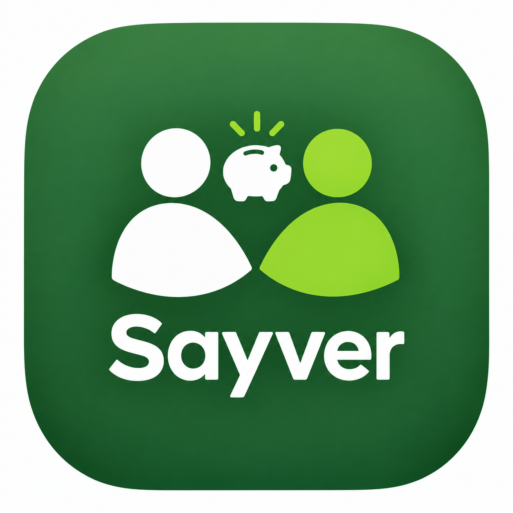
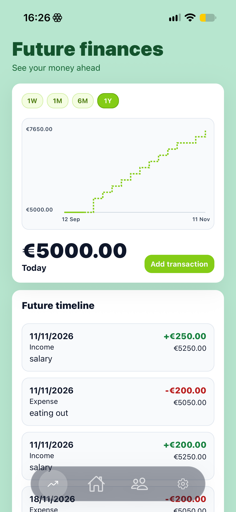
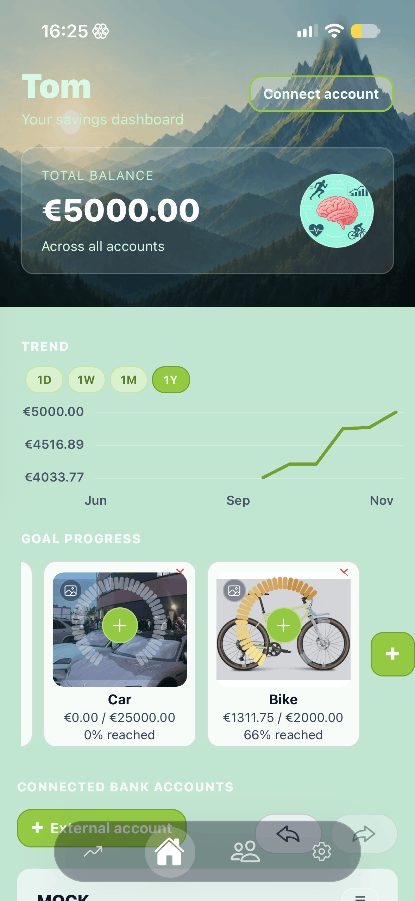
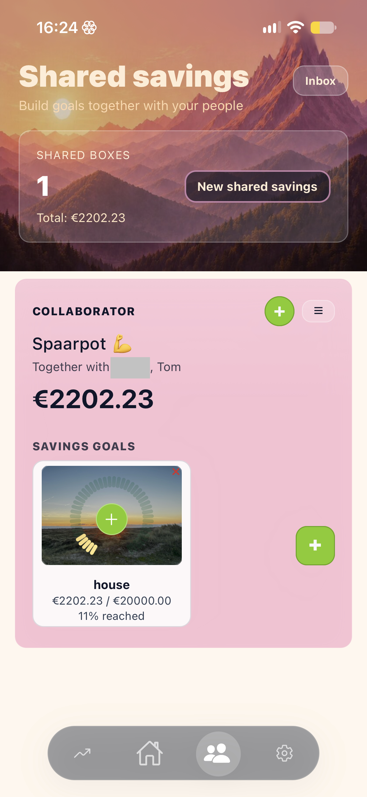
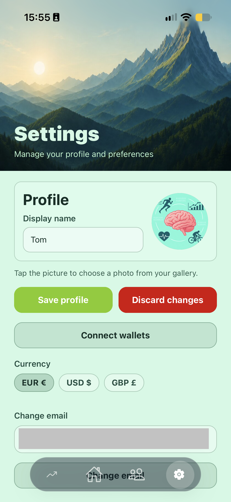

# Sayver

Sayver is a personal-finance and shared-savings mobile app built with Expo and React Native. It combines manual budgeting, shared savings goals, connected bank accounts, read-only investment balances, and read-only crypto wallet tracking.

<p align="center">
  
</p>

## Preview

<p align="center">
  
  
  
  
</p>
To preview the app on a device with Expo Go, start Metro from the repository root:

```sh
npm install
npx expo start --go
```

Scan the QR code with Expo Go. If Expo Go cannot reach Metro on your LAN, use `npx expo start --go --tunnel`. The `npm start` script starts the development-client workflow; use `--go` when previewing in Expo Go.

For a custom development build, use `npx expo start --dev-client` and build/install a development client with EAS. Do not commit simulator screenshots containing personal financial data; use a dedicated demo account if adding screenshots to this README.

## Features

- Personal accounts, transactions, savings goals, and a balance trend.
- Shared savings accounts, invitations, collaborate with others and share savings goals.
- Read-only bank account linking through the Sayver backend and TrueLayer.
- Read-only investment accounts and balances.
- Self-custody wallet balance tracking for Ethereum, Base, and Solana through Alchemy. Only public addresses are accepted; the app does not request private keys or seed phrases.
- Coinbase OAuth scaffolding for read-only crypto balances. Coinbase OAuth requires an approved OAuth application and configured credentials.
- User-owned profile and account data protected by Firestore rules; collaborator email lookup runs in an authenticated server function, while provider credentials and OAuth state remain server-only.

## Project Layout

- `App.js` and `src/navigation/` — app entry, authentication routing, and navigation.
- `src/screens/` — finance, shared-savings, investment, and crypto screens.
- `src/components/` — reusable cards, menus, and controls.
- `src/firebase/` — Firebase client setup, Firestore access, and image uploads.
- `functions/` — default Firebase Functions codebase for Trading 212 and Alchemy wallet functions.
- `functions-coinbase/` — Coinbase OAuth and read-only account sync codebase.
- `functions-zerion/` — isolated legacy Zerion callable; not required for current Alchemy wallet support.
- `sayver-backend/` — Express backend used for TrueLayer bank connections.
- `firestore.rules`, `storage.rules`, and `firestore.indexes.json` — Firebase access policy and indexes.

## Requirements

- Node.js compatible with the installed Expo SDK (Node.js 20 or newer recommended).
- Expo Go for a quick device preview, or Xcode/Android Studio for native development builds.
- A Firebase project with Authentication, Cloud Firestore, Cloud Storage, and Cloud Functions enabled for the features you use.

## Local Setup

1. Install the app dependencies:

   ```sh
   npm install
   ```

2. Review `src/firebase/config.js` and configure the public Firebase web-app settings for your own Firebase project if you are forking Sayver. Firebase client API keys are not server secrets; protect data with Firebase rules and API restrictions.

3. Start the app in Expo Go:

   ```sh
   npx expo start --go
   ```

4. For local TrueLayer development, configure the app's backend URL and backend credentials separately:

   ```sh
   cp .env.example .env.local
   cp sayver-backend/.env.example sayver-backend/.env
   ```

   Edit `.env.local` and set `EXPO_PUBLIC_TRUELAYER_BACKEND_BASE_URL` to an address reachable by your device. Use your computer's LAN IP for a physical phone; use `localhost` for an iOS simulator or the Android emulator fallback. Keep `sayver-backend/.env` private.

   Start the backend separately:

   ```sh
   npm install --prefix sayver-backend
   npm start --prefix sayver-backend
   ```

   The backend template lists the required variables: `PORT`, `ACCOUNTS_CACHE_TTL_MS`, `FIREBASE_PROJECT_ID`, `FIREBASE_WEB_API_KEY`, `FIREBASE_CLIENT_EMAIL`, `FIREBASE_PRIVATE_KEY`, `TRUELAYER_ENV`, `TRUELAYER_CLIENT_ID`, `TRUELAYER_CLIENT_SECRET`, and `TRUELAYER_REDIRECT_URI`. Fill in credentials locally; never commit their values or a machine-specific backend URL.

## Firebase Functions

Each codebase is separate so optional provider credentials do not block unrelated deployments. Install dependencies when working on a codebase:

```sh
npm install --prefix functions
npm install --prefix functions-coinbase
npm install --prefix functions-zerion
```

### Secrets

Set values interactively with the Firebase CLI.

- `functions` (default): `ALCHEMY_API_KEY` for wallet functions; `ENCRYPTION_KEY` for Trading 212 credentials.
- `functions-coinbase` (`coinbase`): `COINBASE_ENCRYPTION_KEY`, `COINBASE_OAUTH_CLIENT_ID`, and `COINBASE_OAUTH_CLIENT_SECRET`. The callback and legacy Coinbase ciphertext migration also require the existing `ENCRYPTION_KEY`; do not rotate it while Trading 212 or legacy Coinbase data depends on it.
- `functions-zerion` (`zerion-legacy`): `ZERION_API_KEY` only if you intentionally deploy the unused legacy callable.

Example secret setup (the CLI prompts for each value):

```sh
npx -y firebase-tools@latest functions:secrets:set ALCHEMY_API_KEY --project <firebase-project-id>
npx -y firebase-tools@latest functions:secrets:set ENCRYPTION_KEY --project <firebase-project-id>
```

Generate encryption keys only for a new project/secret. Never replace an existing encryption key that protects stored credentials.

### Deploy

Deploy only the codebase or functions needed for your configured secrets:

```sh
npx -y firebase-tools@latest deploy --only functions:connectCryptoWallet,functions:syncCryptoWalletsOnDemand --project <firebase-project-id>
npx -y firebase-tools@latest deploy --only functions:coinbase --project <firebase-project-id>
npx -y firebase-tools@latest deploy --only functions:connectTrading212,functions:syncInvestmentBalancesOnDemand,functions:scheduledSyncInvestmentBalances --project <firebase-project-id>
```

For Coinbase, register this server callback URL in the approved Coinbase OAuth application:

```text
https://us-central1-<firebase-project-id>.cloudfunctions.net/oauthCallback
```

The app's separate return URI is `sayver://coinbase-connected`. Coinbase OAuth access is currently limited to approved applications. Do not deploy the legacy Zerion codebase unless you need that integration.

Deploy Firebase rules separately when they change:

```sh
npx -y firebase-tools@latest deploy --only firestore:rules,storage --project <firebase-project-id>
```

## Tests

Run the backend suites independently:

```sh
npm test --prefix functions
npm test --prefix functions-coinbase
```
